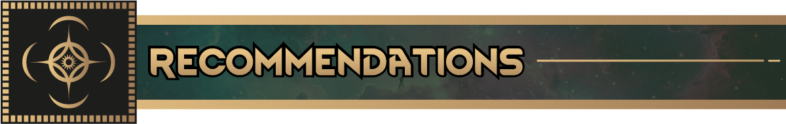
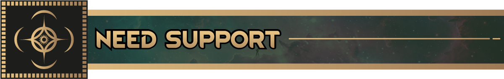
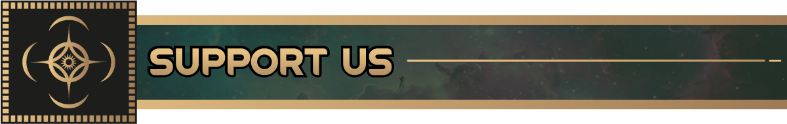
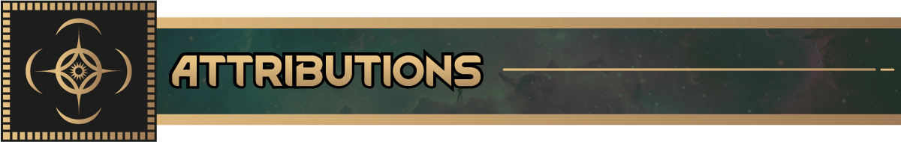

Моды, которые хорошо сочетаются с модами Космера:

* [Nice Bill Tab](https://steamcommunity.com/sharedfiles/filedetails/?id=3520130671)
    * Ржавь! Один из самых красивых модов на интерфейс в этой игре. С ним вкладка заданий становится куда удобнее
* [Nice Health Tab](https://steamcommunity.com/sharedfiles/filedetails/?id=3328729902)
    * Бури! Ещё один от Andromeda. Делает то же самое со вкладкой здоровья
* [Gotta Go Fast](https://steamcommunity.com/sharedfiles/filedetails/?id=3712112476)
    * Ускоряет поиск пути для пешек, которые двигаются быстрее обычного или летают
* [BetterWeight](https://steamcommunity.com/sharedfiles/filedetails/?id=2221387317)
    * Даёт постройкам настоящий вес по материалу, из которого они сделаны. Стальной Толчок и железный Рывок на
      Скадриале ощущаются правильно, когда он стоит. Тяжёлые стальные стены держат Толчок Монетчика. Лёгкая
      деревянная мебель улетает

​

Баги и предложения можно оставить в любом из двух мест ниже. Мы читаем оба.

- [GitHub Source](https://github.com/RimworldCosmere/RimworldCosmere)
- [Discord Community](https://discord.gg/jTcrKfXdYU)

​

Следите за разработкой на https://rimworldcosmere.com

Донаты идут на арт и другие заказы:

* Регулярно: https://rimworldcosmere.com/#/portal/
* Разово: https://rimworldcosmere.com/#/portal/support

​

Спасибо:

* Sir Van ('sir_vann' в Discord) за внутриигровой арт
* Immortalus ('_immortalus' в Discord) за превью модов и ещё кучу арта
* Всем из канала #mod-development в Discord RimWorld, и особенно 'aelanna', за ответы на гору странных вопросов

***Это неофициальный фанатский контент, созданный и распространяемый некоммерчески. Он не проверялся Dragonsteel
Entertainment, LLC или Ludeon Studios.***