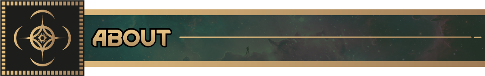
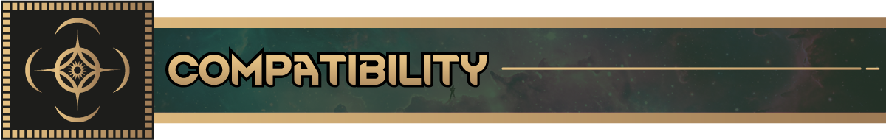
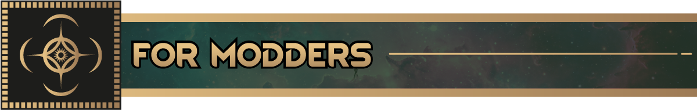

*El framework compartido sobre el que se construyen los demás mods del Cosmere.*

​

Cosmere Core trae la fontanería de Investidura sobre la que se apoyan los demás mods del Cosmere. Por sí solo te da
el framework, no la magia. La Alomancia, la Encauzación y el resto llegan con sus propios mods de Esquirla.

Incluye:

- **Nuevos StatDefs**
    - `MentalBreakAddFactor`: cambia la probabilidad de que un colono sufra un brote mental
    - `MentalBreakRemoveFactor`: cambia la probabilidad de que lo calmen y salga de uno
    - `Cosmere_Time_Dilation_Factor`: lo usan sobre todo los quemadores de bendaleo y cadmio de Scadrial, para
      ajustar cosas que no tienen estadística propia (la velocidad de quemado del metal, por ejemplo)
    - `Cosmere_Investiture`: cuánta Investidura lleva encima un colono

- **Necesidad de Investidura**  
  Una necesidad que alimenta las habilidades investidas en todos los mundos de Esquirla

- **Proyecto de investigación de Investidura**  
  Abre la parte del juego ligada a la Investidura

- **Rasgo Investido**  
  Investidura innata, modelada sobre los Grados de Nalthis

- **Sistema de selección de Esquirlas**  
  Un componente de partida para elegir qué Esquirlas existen en tu mundo  
  (Scadrial, Roshar y Nalthis se activan solas según el escenario que escojas)

​

- Las demás expansiones del Cosmere requieren este mod
- Se puede añadir al empezar una partida sin problema
- Requiere Biotech. Los sistemas de genes y xenotipos recorren todo esto, así que no hay forma de separarlos
- Hecho para RimWorld 1.7, y funciona junto a Biotech, Ideology, Royalty y Anomaly

​

Core es el dueño de los rasgos, necesidades y estadísticas compartidos, para que todos los mundos de Esquirla lean
lo mismo.  
Registra una Esquirla nueva a través del componente de partida y engánchate al sistema de Investidura.

​
